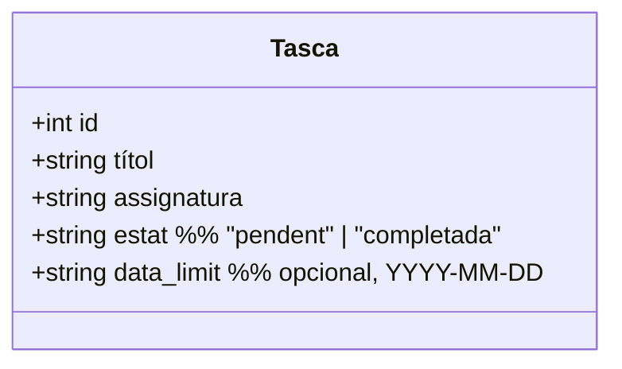

# SPECIFICATIONS.md — Sistema Tasks_app (v2.0)

## 1. Visió General
Tasks_app és una eina CLI lleugera per ajudar als estudiants a gestionar les seves tasques
acadèmiques diàries.

### 1.1 Històric d'iteracions
| Versió | Iteració | Què s'incorpora |
|--------|----------|-----------------|
| v1.0 | Sprint 1 | Crear una tasca (`add`) i llistar-les (`list`). US-01, US-02; RF-01…RF-04; GS-01…GS-03. |
| v2.0 | Sprint 2 | Data límit, modificar tasca (`edit`), completar tasca (`done`), indicadors `[CADUCADA]` i `[URGENT]`. US-03…US-06; RF-05…RF-16; GS-04…GS-17. |

### 1.2 Definicions
- **Tasca pendent**: tasca amb estat `pendent`. **Tasca completada**: tasca amb estat `completada`.
- **Data actual**: la data indicada a la variable d'entorn `TASKS_APP_AVUI` o, si no existeix, la del sistema.
- **Tasca caducada**: tasca pendent amb data límit anterior a la data actual.
- **Tasca urgent**: tasca pendent amb data límit igual o posterior a la data actual i inferior a 7 dies
  respecte a la data actual (0 a 6 dies restants).
- Una tasca caducada o urgent és sempre també una tasca pendent. Una tasca no pot ser alhora caducada i urgent.
- **Registre**: conjunt de totes les tasques de `data/tasks.json`.

## 2. User Stories (Històries d'Usuari)
- US-01: Com a estudiant, vull afegir una tasca amb títol i assignatura per recordar els meus deures.
- US-02: Com a estudiant, vull veure la llista de tasques pendents per organitzar el meu temps.
- US-03: Com a estudiant, vull indicar una data límit en donar d'alta una tasca per saber quan l'he de lliurar.
- US-04: Com a estudiant, vull modificar qualsevol atribut d'una tasca per corregir els errors comesos en registrar-la.
- US-05: Com a estudiant, vull marcar una tasca com a completada per deixar de veure-la com a pendent.
- US-06: Com a estudiant, vull veure en el llistat quines tasques estan caducades o són urgents per prioritzar la feina.

## 3. Model de Dades (Mermaid)

## 4. Requisits

### 4.1 Persistència (Sprint 1)
- RF-01: El sistema tasks_app ha de guardar les tasques en un fitxer JSON de persistència local.
- RF-02: Si el fitxer `data/tasks.json` no existeix, el sistema tasks_app ha de crear `data/tasks.json` inicialitzat amb una llista JSON buida (`[]`).

### 4.2 Crear i llistar (Sprint 1)
- RF-03: El sistema tasks_app ha de proveir a l'estudiant la capacitat de crear una nova tasca amb estat 'pendent' mitjançant el comandament `add --title <títol> --subject <assignatura>`.
- RF-04: El sistema tasks_app ha de proveir a l'estudiant la capacitat de visualitzar totes les tasques registrades (incloent-hi el seu ID, títol, assignatura i estat) mitjançant el comandament `list`.

### 4.3 Data límit (Sprint 2)
- RF-05: El sistema tasks_app ha de proveir a l'estudiant la capacitat d'indicar, de manera opcional, una data límit en crear una tasca mitjançant l'opció `--due YYYY-MM-DD` del comandament `add`.
- RF-06: Si l'estudiant indica una data límit que no té el format `YYYY-MM-DD` o que no és una data de calendari vàlida, el sistema tasks_app ha de mostrar `Error: data límit invàlida (format esperat YYYY-MM-DD).` i no ha de crear la tasca.
- RF-07: Si una tasca té data límit, el sistema tasks_app ha de mostrar-la en el llistat afegint ` - límit: YYYY-MM-DD` darrere de l'estat.
- RF-08: Si una tasca no té data límit, el sistema tasks_app ha de mostrar-la en el llistat sense cap indicació de data límit.

### 4.4 Modificar una tasca (Sprint 2)
- RF-09: El sistema tasks_app ha de proveir a l'estudiant la capacitat de modificar el títol, l'assignatura, la data límit o l'estat d'una tasca mitjançant el comandament `edit --id <ID>` acompanyat d'una o més de les opcions `--title <títol>`, `--subject <assignatura>`, `--due YYYY-MM-DD` i `--status <pendent|completada>`.
- RF-10: Si l'ID indicat en un comandament `edit` o `done` no correspon a cap tasca del registre, el sistema tasks_app ha de mostrar `Error: tasca [ID: <ID>] no trobada.` i no ha de modificar el registre.
- RF-11: Si el comandament `edit` no inclou cap opció de modificació, el sistema tasks_app ha de mostrar `Error: cal indicar almenys un atribut a modificar.` i no ha de modificar el registre.
- RF-12: Quan el sistema tasks_app modifica una tasca amb èxit, el sistema ha de mostrar `Tasca [ID: <ID>] modificada amb èxit`.
- RF-13: Si el valor de `--due` o de `--status` d'un comandament `edit` no és vàlid, el sistema tasks_app ha de mostrar un missatge d'error (RF-06 per a la data; `Error: estat invàlid (valors admesos: pendent, completada).` per a l'estat) i no ha de modificar la tasca.

### 4.5 Completar una tasca (Sprint 2)
- RF-14: El sistema tasks_app ha de proveir a l'estudiant la capacitat de marcar una tasca com a completada mitjançant el comandament `done --id <ID>`.
- RF-15: Quan l'estudiant marca una tasca com a completada, el sistema tasks_app ha de canviar-ne l'estat a 'completada' i mostrar `Tasca [ID: <ID>] completada`.

### 4.6 Indicadors de caducitat (Sprint 2)
- RF-16: Quan el comandament `list` mostra una tasca caducada, el sistema tasks_app ha d'afegir `[CADUCADA]` al final de la línia de la tasca; quan mostra una tasca urgent, hi ha d'afegir `[URGENT]`. Una tasca completada o sense data límit no ha de portar cap d'aquests indicadors.

## 5. Criteris d'acceptació i proves (Gherkin scenarios)

### Sprint 1
- GS-01: Creació correcta d'una tasca
  Atès que la base de dades JSON no conté encara tasques
  quan l'estudiant executa `python src/tasks_app.py add --title 'Pràctica 1' --subject 'RS'`
  aleshores el sistema confirma `Tasca [ID: 1] creada amb èxit`
  i la tasca queda registrada al fitxer `data/tasks.json`.

- GS-02: Llistat de tasques quan `data/tasks.json` no conté registres
  Atès que la base de dades JSON no conté encara tasques
  quan l'estudiant executa `python src/tasks_app.py list`
  aleshores el sistema mostra `Registre de tasques buit.`

- GS-03: Llistat de tasques quan data/tasks.json conté registres
  Atès que el fitxer `data/tasks.json` conté les següents tasques:
    | id | títol          | assignatura | estat   |
    | 1  | Pràctica 1     | RS          | pendent |
    | 2  | Examen parcial | SO          | pendent |
  quan l'estudiant executa `python src/tasks_app.py list`
  aleshores el sistema mostra per pantalla:
    "[1] Pràctica 1 (RS) - estat: pendent"
    "[2] Examen parcial (SO) - estat: pendent"

### Sprint 2
- GS-04: Creació d'una tasca amb data límit (RF-05, RF-07)
  Atès que el registre no conté tasques
  quan l'estudiant executa `add --title 'Entrega RS' --subject 'RS' --due 2026-12-15`
  aleshores el sistema confirma `Tasca [ID: 1] creada amb èxit`
  i la tasca queda registrada amb data límit `2026-12-15`.

- GS-05: Creació amb data límit invàlida (RF-06)
  Atès que el registre no conté tasques
  quan l'estudiant executa `add --title 'X' --subject 'RS' --due 15/12/2026`
  aleshores el sistema mostra `Error: data límit invàlida (format esperat YYYY-MM-DD).`
  i el registre continua sense tasques.

- GS-06: Creació amb data de calendari inexistent (RF-06)
  Atès que el registre no conté tasques
  quan l'estudiant executa `add --title 'X' --subject 'RS' --due 2026-02-30`
  aleshores el sistema mostra `Error: data límit invàlida (format esperat YYYY-MM-DD).`
  i el registre continua sense tasques.

- GS-07: Modificació del títol d'una tasca (RF-09, RF-12)
  Atès que el registre conté la tasca 1 'Pràctica 1' (RS) pendent
  quan l'estudiant executa `edit --id 1 --title 'Pràctica 1 revisada'`
  aleshores el sistema mostra `Tasca [ID: 1] modificada amb èxit`
  i la tasca 1 té títol 'Pràctica 1 revisada', mantenint l'assignatura i l'estat.

- GS-08: Modificació de diversos atributs alhora (RF-09)
  Atès que el registre conté la tasca 1 'Pràctica 1' (RS) pendent
  quan l'estudiant executa `edit --id 1 --subject 'SO' --due 2026-12-20`
  aleshores la tasca 1 té assignatura 'SO' i data límit '2026-12-20'.

- GS-09: Modificació d'una tasca inexistent (RF-10)
  Atès que el registre no conté la tasca amb ID 7
  quan l'estudiant executa `edit --id 7 --title 'X'`
  aleshores el sistema mostra `Error: tasca [ID: 7] no trobada.`
  i el registre no canvia.

- GS-10: Modificació sense cap atribut (RF-11)
  Atès que el registre conté la tasca 1
  quan l'estudiant executa `edit --id 1`
  aleshores el sistema mostra `Error: cal indicar almenys un atribut a modificar.`

- GS-11: Modificació amb estat invàlid (RF-13)
  Atès que el registre conté la tasca 1 pendent
  quan l'estudiant executa `edit --id 1 --status acabada`
  aleshores el sistema mostra `Error: estat invàlid (valors admesos: pendent, completada).`
  i la tasca 1 continua 'pendent'.

- GS-12: Completar una tasca (RF-14, RF-15)
  Atès que el registre conté la tasca 1 'Pràctica 1' amb estat 'pendent'
  quan l'estudiant executa `done --id 1`
  aleshores el sistema mostra `Tasca [ID: 1] completada`
  i la tasca 1 té estat 'completada'.

- GS-13: Completar una tasca inexistent (RF-10)
  Atès que el registre no conté la tasca amb ID 9
  quan l'estudiant executa `done --id 9`
  aleshores el sistema mostra `Error: tasca [ID: 9] no trobada.`

- GS-14: Llistat d'una tasca caducada (RF-07, RF-16)
  Atès que la data actual és 2026-11-24
  i el registre conté la tasca 1 'Pràctica 1' (RS) pendent amb límit 2026-11-20
  quan l'estudiant executa `list`
  aleshores el sistema mostra `[1] Pràctica 1 (RS) - estat: pendent - límit: 2026-11-20 [CADUCADA]`.

- GS-15: Llistat d'una tasca urgent, límit en 6 dies (RF-16)
  Atès que la data actual és 2026-11-24
  i el registre conté la tasca 1 'Pràctica 1' (RS) pendent amb límit 2026-11-30
  quan l'estudiant executa `list`
  aleshores el sistema mostra `[1] Pràctica 1 (RS) - estat: pendent - límit: 2026-11-30 [URGENT]`.

- GS-16: Tasca amb límit en 7 dies o més, sense indicador (frontera) (RF-16)
  Atès que la data actual és 2026-11-24
  i el registre conté la tasca 1 'Pràctica 1' (RS) pendent amb límit 2026-12-01
  quan l'estudiant executa `list`
  aleshores el sistema mostra `[1] Pràctica 1 (RS) - estat: pendent - límit: 2026-12-01`
  sense `[URGENT]` ni `[CADUCADA]`.

- GS-17: Tasca amb límit avui i tasca completada amb límit passat (RF-16)
  Atès que la data actual és 2026-11-24
  i el registre conté la tasca 1 'A' (RS) pendent amb límit 2026-11-24
  i la tasca 2 'B' (SO) completada amb límit 2026-11-01
  quan l'estudiant executa `list`
  aleshores el sistema mostra `[1] A (RS) - estat: pendent - límit: 2026-11-24 [URGENT]`
  i `[2] B (SO) - estat: completada - límit: 2026-11-01` (sense indicador).
